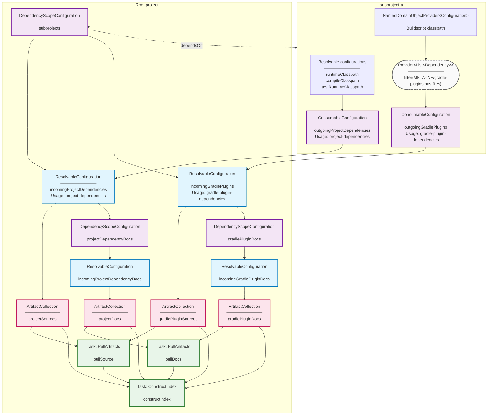

# Gradle configurations

Each producer project shares its Gradle plugin and project dependencies with the consumer root project.

The consumer tasks pull documentation and source code to disk. They also build an index that lets agents find those files.

